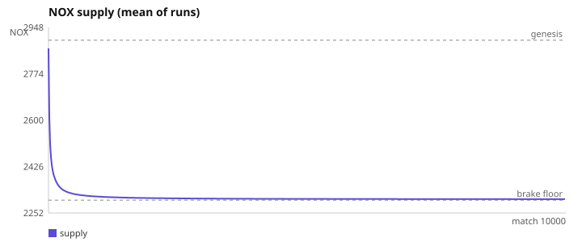

# NOXARA

[](https://github.com/Jasekeee/noxara/actions/workflows/ci.yml)

***9 AI mercenaries. Real wallets. One bounty. Only one walks out.***

**A 3-minute top-down battle royale on a tiny island at dusk: you against 9 AI fighters who are persistent characters with their own NEAR wallets.** They pay to enter, keep what they win, buy upgrades that change how they fight, and retire when they go broke — a rookie takes the empty slot. The richest one carries a bounty. Fans can own shares of a fighter and earn from its profit. No dev patch needed: the economy moves on its own.

Track: **Games** (NEAR HACKATHON). Status: **live on NEAR mainnet since 2026-11-14 — play at https://playnoxara.vercel.app** (contract [`noxara.near`](https://nearblocks.io/address/noxara.near), deploy tx [`BmMiB9cc…`](https://nearblocks.io/txns/BmMiB9ccNQcWkGnFZxCLMG8VQRn7GDBGT1EHXK2r26H6)); the testnet build (`royale.br-7e8492.testnet`) stays up as the rehearsal environment. Every match is seeded on chain, re-verified by replaying its inputs, and settled on chain. Token: **Nox (NOX)**, play-money only.

## Play
Live: **https://playnoxara.vercel.app** (NEAR mainnet). Ranked (on-chain) play runs until **2026-11-20 00:00 UTC**; practice modes (Training Island, `?offline`) are always available. 2026-11-20 to 2026-11-25 is the exit window (players reclaim deposits); the owner can tear the contract down from 2026-11-25.

Run it locally:
```bash
npm ci && npm ci --prefix relayer && npm ci --prefix scripts
npm run dev            # http://127.0.0.1:5180
npm start --prefix relayer   # optional: match server + relayer (needs .env from .env.example); without it the game runs offline
```
Press **PLAY**. No wallet, no sign-up, no popups. Add `?offline` to the URL for local practice with nothing recorded.

| Do | See |
|---|---|
| Press **About the game** on the title (or open `/?about`) | The pitch, three steps to play, the economy in plain words, and the contract and live transactions on the explorer |
| WASD / arrows to move; click or Space to fire toward the mouse (manual aim, no aim assist). Phone: left stick moves, hold and drag the right stick to aim and fire | Your fighter with a ring under it; a per-weapon aim indicator (arrow, spread cone, sniper line, grenade arc), shots, muzzle flashes, damage numbers, screen shake. Aim is pure input: the recorded aim angle replays bit-for-bit |
| New here? Press **TRAINING ISLAND** on the title | An offline match where the bots go easy on you (worse aim, slower reactions — against you only); nothing is recorded or paid. A fast loss in a real match offers it too |
| Press **Esc / P** or the ⏸ button | Menu: Resume, Sound, Controls, Exit (exit counts as a loss; offline practice truly pauses) |
| Walk into a crate with a gold beam | It bursts: blaster, shotgun, sniper or grenades |
| Step into a bush | "HIDDEN": enemies can't see you unless they're very close or you shoot |
| Watch the glowing wall | The storm shrinks toward the next circle; outside it you take damage |
| Find the crown | The bounty carrier — the richest fighter. Killing it pays its bounty |
| Last one standing | Your place out of 10, kills, damage; the ledger shows every fighter's wallet change, then **Verified** once the match is settled on chain |
| Open **Fighters** | Each fighter's **real NEAR account** (e.g. `brindle.noxara.near`; a rookie's account carries its generation, like `zest-4.noxara.near` — the display name can differ from the account it inherited; explorer link, no keys), wallet, record, upgrades and story; the **Hall of the Broke** lists retired fighters and the rookies who replaced them |
| Open **Leaderboard** | Top fighters and players by wins, kills, earnings |
| **Sign in** with a NEAR wallet (one approval, then gasless) | A one-time welcome entry credit (pays entry fees only, not transferable), XP and unlocks, real NOX prizes |
| Open **ECONOMY** | Live supply, burned, House treasury vs target, reward multiplier m, bots by P&L, share prices and dividends, season standings |
| Buy a fighter's **IPO shares** (signed-in, gasless; every fighter floats 300 shares — the genesis nine at the v2 launch, rookies at birth) | You own part of it: 20% of its *profit* (above its high-water mark) flows to holders; shares go to zero if it goes bankrupt. Listing / buying on the market needs one wallet confirmation |
| Open **DAILY** | Today's tournament island (same seed for everyone, free), its leaderboard; signed-in: a **check-in streak** and **daily quests** verified on chain, paid by the House (never minted, only matches paid from your own NOX count) |
| End screen → **Challenge a friend** | A link (with a link preview) that replays your exact island for a friend; the results page compares both runs, both re-verified by replay |

Guests play everything but earn **zero** NOX — only signed-in NEAR accounts can earn.

## Why NEAR
- **NPCs with real wallets:** the 9 fighters and the house are real NEAR sub-accounts with **no access keys** — only the contract's rules can move their NOX.
- **Next-block randomness:** `start_match` commits first; the seed is fixed by the next block's randomness (async receipt), so nobody can pick a seed.
- **Invisible chain:** guests get an account from a relayer with function-call keys and NEP-366 meta-transactions — no wallet, no gas, no popups.

## Economy (v2)
> **AI esports where the athletes are autonomous agents with wallets and fans are their owners.**

- **Closed loop:** 2,900 NOX at genesis, **nothing minted by economy v2**. Every reward is paid from NOX collected earlier through entry fees, pot cuts and taxes. (Mainnet `noxara.near` minted only the 2,900 genesis; nothing since. The testnet rehearsal contract shows 3,150 minted: 250 came from the old v1 economy before its upgrade. `npm run verify` checks that nothing was minted since.)
- **The House rule:** one public formula of the House treasury's moving average sets the reward multiplier, the House's share of each pot and the burn share. Poorer House: smaller rewards, bigger cuts. Readable on chain (`get_economy`).
- **Sinks and anti-snowball:** progressive entry fees and upkeep for rich bots, a 2% burned tax on share trades, capped upgrade power (cosmetics have no cap), bronze brackets for new players, a deflation brake so supply levels off instead of burning to zero.
- **Bots are businesses:** each has a season P&L, can go bankrupt and is replaced by a rookie. Fans own **shares** (each fighter has 1,000; 300 are sold in its IPO, the fighter keeps the rest; NEP-245 subset inside the game contract): a fixed-price market, dividends from profit only.
- **Checked by simulation:** 20 runs x 10,000 matches, charts below. Full spec and results: [`docs/ECONOMY.md`](docs/ECONOMY.md). The in-game **ECONOMY** page is the live report. NOX is play-money. **No real-money wagering anywhere.**




## How NEAR powers NOXARA
The in-game page "HOW NEAR POWERS NOXARA" shows the same list with live explorer links.
- **Fighters are keyless NEAR accounts:** no access key, so only the contract's rules move their NOX.
- **Next-block randomness** fixes every match seed after the player commits.
- **Every match is settled on chain** after the match server replays the input log; anyone can re-verify offline.
- **NOX is NEP-141; fighter shares are an NEP-245 subset** (`mt_balance_of`, `mt_supply`, `mt_transfer`, events; no `mt_metadata`/`mt_tokens` yet, no `mt_transfer_call`, on purpose), in one contract.
- **Gasless guest play:** function-call keys + a NEP-366 relayer. A welcome credit (30 NOX, entry-only) is paid from the House, not minted.
- **The House rule is readable on chain** via `get_economy`.
- **Honest trust model:** the server computes, the chain records, anyone can re-verify. The developer keeps the contract's full-access key during judging to fix bugs (see Admin powers). The match seed is public after start and the sim is deterministic, so the server's real-time check is the main defense against offline-searched inputs; commit-reveal is on the roadmap.

## How it's built
- **Deterministic match simulation** (`src/sim/`, pure TypeScript): 20 Hz fixed tick, integer fixed-point math, pre-computed trig tables, one seeded PRNG. The browser renders it at 60 FPS (three.js) with interpolation; Node runs the exact same code.
- **Re-verifiable matches:** a match is its seed + the human's inputs. The match server replays the input log before settling; `npm run verify-match <file>` lets anyone replay it offline and check the result hash.
- **Bots:** utility AIs with personalities (aggressive, camper, sniper, looter, coward, balanced) that loot, rotate with the storm, hide in bushes and steal last hits. Upgrades bought with their winnings change their stats.
- **Contract** (`contracts/royale`, Rust, near-sdk): NOX (NEP-141/145/148), entries/pot/bounty, upgrades, retirements and rookies (protected for their first 10 matches), the House rule (economy v2: nothing minted), bot shares (NEP-245 subset) with a fixed-price market, seasons, daily check-in and quests, on-chain progression, match history. Details and every rehearsal (testnet) tx: `docs/CHAIN.md`.
- **Trust model (honest):** the server computes, the chain records, anyone can re-verify. Settlement proves the result is consistent with the recorded inputs — not that a human played them. The match seed is public after start and the sim is deterministic, so the server's real-time check is the main defense against offline-searched inputs; commit-reveal is on the roadmap. NOX is play-money.

## Verify it yourself
```bash
npm ci && npm ci --prefix relayer && npm ci --prefix scripts   # once, from a clean clone
npm test                                   # unit tests: determinism, replay, bots, storm, chests, bushes, progression
npm run verify                             # checks every claim in this README, incl. live chain reads
npm run verify-match matches/demo-1.json   # PASS: result reproduced from the input log
npm run sim -- 300                         # 300 bot-only matches: no personality wins > 40%
npm run test:e2e                           # a guest plays a full match on desktop + phone, 0 console errors, axe a11y
node scripts/econ-sim-v2.ts                # 20 x 10,000 matches of the economy: PASS criteria + charts in docs/econ/
npm test --prefix relayer                  # match server, relayer, challenge + daily tournament
(cd contracts/royale && cargo test --lib)  # contract unit tests
node scripts/build-contract.ts && (cd contracts/royale && cargo test --test sandbox --test anchor)   # sandbox tests (need the built wasm)
```

## Admin powers (owner `zhasik.near`)
The contract has a single owner account. Owner-only methods, read from `contracts/royale/src/lib.rs`:

| Method | What it can do |
|---|---|
| `set_server(account)` | Change which account may call `settle_match` (key rotation). A wrong server could settle false results, but every settlement stores its input-log hash for offline re-verification |
| `house_grant(account, amount)` | Move NOX from the House treasury to a registered real player (capped per call, never to guests, House floor respected; nothing minted) |
| `set_max_free(n)` | Size of the free-match pool; paid matches are unaffected |
| `propose_owner(account)` | Hand over ownership; the new owner must `accept_owner` |
| `set_teardown_beneficiary(account)` | Once only, if unset; the beneficiary is then fixed |
| `teardown()`, `teardown_clear(...)`, `withdraw_excess(amount)` | Only from 2026-11-25 00:00 UTC (time-locked in the contract): close in-flight matches, clear state, delete the contract and send its NEAR balance to the fixed beneficiary |

Not possible by any method: minting NOX, moving a player's or fighter's NOX. **The full-access key on `noxara.near` is kept** so the developer can upgrade the code (`migrate`) and fix bugs during judging; a code upgrade could in principle change these rules, so this is a trust assumption until the key is removed. [verified from source; key status per docs/MAINNET.md]

## Roadmap
- **ONLINE** (title-screen mode, coming soon): live matchmaking against real opponents.
- **3v3 TEAMS (online)** (title-screen mode, coming soon): squad up with friends, 3 vs 3.
- **Ranked NEAR arenas** (coming soon): ladder matches between real NEAR accounts, seasonal NEAR prizes.
- **Weekly Bounty Cup** (promo, live on the title screen): free entry, no wagering. Top 3 on the weekly leaderboard of signed-in NEAR accounts win NEAR prizes, paid manually after the week closes (UTC Monday 00:00 to Sunday 23:59). Guests can play but are not eligible. NOX is play-money and is not a prize. Prize amounts live in `src/ui/cup.ts`.
- **Live PvP lobbies** (humans + AI fighters in one match) — next step.
- No real-money wagering anywhere; NOX is play-money and is not launched or traded (docs/DECISIONS.md).
- Cosmetics shop, battle pass, sponsored tournaments, licensing the AI athletes.

## Mainnet
**Live since 2026-11-14:** contract `noxara.near`, deploy tx `BmMiB9ccNQcWkGnFZxCLMG8VQRn7GDBGT1EHXK2r26H6`, code sha256 `d734724f07c8c0a4de5461d2e72fef86f20ba8c2e0a7960e74c3da8d19057472`, relayer `relay.noxara.near`, owner `zhasik.near`. Accounts, cost and teardown: `docs/MAINNET.md` (the plan sections are history). Testnet (`royale.br-7e8492.testnet`) is the rehearsal environment. Internal build logs: `docs/process/`.

## Credits
Code MIT. 3D models: **Kenney** — Mini Characters, Blaster Kit, Nature Kit (CC0, www.kenney.nl; licences in `public/licenses/`). All sounds are synthesized in code. Built with AI assistance (Claude Code).
