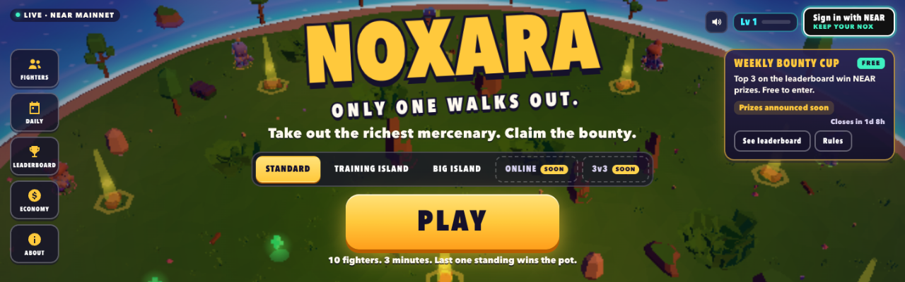
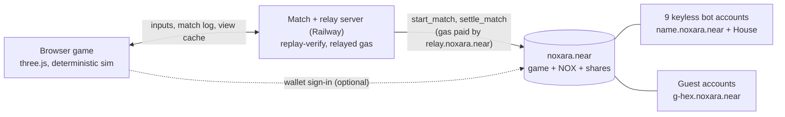
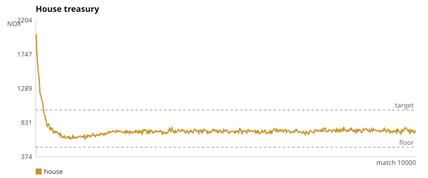

  

<h1 align="center">NOXARA</h1>

<b><i>9 AI mercenaries. Real wallets. One bounty. Only one walks out.</i></b>

  
  
  
  

<b>▶ Play now: <a href="https://playnoxara.vercel.app">https://playnoxara.vercel.app</a></b> (no wallet, no sign-up)

<!-- TRAILER: thumbnail docs/media/trailer-thumb.png linking to the X video, added after posting -->

A 3-minute top-down battle royale on a tiny island at dusk: you against **9 AI fighters that are persistent characters with their own NEAR wallets**. They pay to enter, keep what they win, buy upgrades that change how they fight, and retire when they go broke; a rookie takes the empty slot. The richest one carries a bounty. Fans can own shares of a fighter and earn from its profit. No dev patch needed: the economy moves on its own.

Track: **Games** (NEAR HACKATHON). Status: **live on NEAR mainnet since 2026-11-14**: contract [`noxara.near`](https://nearblocks.io/address/noxara.near), deploy tx [`BmMiB9cc…`](https://nearblocks.io/txns/BmMiB9ccNQcWkGnFZxCLMG8VQRn7GDBGT1EHXK2r26H6), code sha256 `d734724f07c8c0a4de5461d2e72fef86f20ba8c2e0a7960e74c3da8d19057472`. The testnet build (`royale.br-7e8492.testnet`) stays up as the rehearsal environment. Every match is seeded on chain, re-verified by replaying its inputs, and settled on chain. Token: **Nox (NOX)**, play-money only.

Ranked (on-chain) play: until 2026-11-20 00:00 UTC (an extension to 2026-12-15 is pending a contract upgrade)

Practice modes (Training Island, `?offline`) are always available. After the ranked window there is an exit window (players reclaim deposits); the owner can tear the contract down from 2026-11-25 (time-locked in the contract; see [`docs/MAINNET.md`](docs/MAINNET.md)).

## 60-second judge path
1. Open **https://playnoxara.vercel.app** and press **PLAY** as a guest (WASD to move, click to fire; on a phone: left stick moves, drag the right stick to aim).
2. Play the 3-minute match (or press **TRAINING ISLAND** for an easier warm-up). Win, or just finish.
3. On the end screen the ledger shows every fighter's wallet change, then **Verified** once the match is settled on chain.
4. Open the settlement on NearBlocks, for example [`3fBKspfL…`](https://nearblocks.io/txns/3fBKspfLP66JFX3WvXFQ3QGk37rmKi3Jqb8s2FNgaJKM): a real `settle_match` call to `noxara.near` carrying the placements, kills, result hash and input-log hash [verified, NearBlocks API, 2026-11-14].
5. Re-check it yourself: `npm ci && npm ci --prefix relayer && npm ci --prefix scripts && npm run verify` (11 checks against live mainnet).

Every control and screen, with what you should see: [`docs/GAMEPLAY.md`](docs/GAMEPLAY.md).

## What makes it different
- **The NPCs are real economic actors.** Nine fighters and the House are real NEAR sub-accounts (`brindle.noxara.near`, ...) with **no access keys**: only the contract's rules can move their NOX. They enter, win, get upgrades, go bankrupt and are replaced.
- **You can own a fighter.** Each has 1,000 shares (300 sold in its IPO); 20% of its profit flows to holders. The fighter's story is the game's meta-layer.
- **Judged on the loop, not the token.** It is a tight 3-minute arena shooter first (manual aim, bushes, a shrinking storm, a bounty crown). The chain is invisible: guests play in seconds with no wallet and no gas.
- **Every match is re-verifiable.** A match is its seed plus the human's inputs; a deterministic sim (integer fixed-point, one seeded PRNG) means anyone can replay it and get the same result hash.

## How NEAR powers NOXARA
| NEAR feature | How NOXARA uses it | Look at it live |
|---|---|---|
| Smart contract (Rust, near-sdk) | `noxara.near` holds the game, NOX and fighter shares | [account](https://nearblocks.io/address/noxara.near) |
| Keyless NPC accounts | Fighters have no access keys; only contract rules move their funds | [`brindle.noxara.near`](https://nearblocks.io/address/brindle.noxara.near), [`tallow.noxara.near`](https://nearblocks.io/address/tallow.noxara.near) |
| Gasless guests (NEP-366 meta-transactions + `create_guest`) | A guest gets a `g-<hex>.noxara.near` account from the contract; the relayer pays gas via function-call keys and delegate actions | relayer [`relay.noxara.near`](https://nearblocks.io/address/relay.noxara.near) |
| Next-block randomness | `start_match` commits first; the seed is fixed by the next block's randomness (async receipt), so nobody can pick a seed | `start_match` / `settle_match` calls on the [contract's transactions](https://nearblocks.io/address/noxara.near) |
| On-chain settlement | The match server replays the input log, then `settle_match` records placements, kills, bounty killer, result hash and input-log hash | [settle tx `3fBKspfL…`](https://nearblocks.io/txns/3fBKspfLP66JFX3WvXFQ3QGk37rmKi3Jqb8s2FNgaJKM) |
| NEP-141 token (+145, 148) | NOX (18 decimals, play-money) lives in the game contract | `ft_metadata` view call on `noxara.near`: name "Nox", symbol "NOX", decimals 18 (live RPC read, 2026-11-14) |
| NEP-245 subset | Fighter shares: `mt_balance_of`, `mt_supply`, `mt_transfer`, events. **A subset**: no `mt_metadata`/`mt_tokens` yet, no `mt_transfer_call`, on purpose | contract source `contracts/royale/` |

## Architecture

Server: https://noxara-production.up.railway.app (`/api/health`). The same TypeScript sim (`src/sim/`) runs in the browser and in Node, so the server's replay equals what the player saw.

## Economy in 6 bullets
- **Closed loop:** 2,900 NOX minted at genesis, nothing minted since by economy v2; every reward is paid from NOX collected earlier. `npm run verify` checks mainnet minted = 2,900 NOX. (The testnet rehearsal contract shows 3,150 minted: 250 came from the old v1 economy before its upgrade.)
- **The House rule:** one public formula of the House treasury's moving average sets the reward multiplier, the House's pot share and the burn share. Poorer House, smaller rewards. Readable on chain via `get_economy`.
- **Sinks and anti-snowball:** progressive entry fees and upkeep for rich bots, a 2% burned tax on share trades, capped upgrade power, bronze brackets for new players, a deflation brake.
- **Bots are businesses:** season P&L, bankruptcy, rookie replacement (protected for their first 10 matches).
- **Fans own shares:** fixed-price market, dividends from profit above the high-water mark only; shares go to zero if the fighter goes bankrupt.
- **Checked by simulation:** 20 runs x 10,000 matches (`node scripts/econ-sim-v2.ts`). NOX is play-money; **no real-money wagering anywhere**. Full spec and results: [`docs/ECONOMY.md`](docs/ECONOMY.md).

Guests play everything but earn **zero** NOX; only signed-in NEAR accounts can earn.

## Trust model (honest)
- **The server computes, the chain records, anyone can re-verify.** Settlement proves the result is consistent with the recorded inputs, not that a human played them. Every settlement stores its input-log hash; `npm run verify-match <file>` replays a match offline.
- **Public seed limitation:** the seed is public after `start_match` and the sim is deterministic, so the server's real-time check is the main defense against offline-searched inputs. Commit-reveal seeds are on the roadmap.
- **The owner keeps the contract's full-access key** during judging so bugs can be fixed (`migrate`). A code upgrade could in principle change these rules, so this is a trust assumption until the key is removed [verified from source; key status per [`docs/MAINNET.md`](docs/MAINNET.md)].
- **Match server is a single trusted operator today**; running it inside a TEE is on the roadmap.

Admin powers (owner <code>zhasik.near</code>), read from <code>contracts/royale/src/lib.rs</code>

| Method | What it can do |
|---|---|
| `set_server(account)` | Change which account may call `settle_match` (key rotation). A wrong server could settle false results, but every settlement stores its input-log hash for offline re-verification |
| `house_grant(account, amount)` | Move NOX from the House treasury to a registered real player (capped per call, never to guests, House floor respected; nothing minted) |
| `set_max_free(n)` | Size of the free-match pool; paid matches are unaffected |
| `propose_owner` / `accept_owner`, `set_teardown_beneficiary` | Hand over ownership; set the teardown beneficiary once |
| `teardown()`, `teardown_clear(...)`, `withdraw_excess(amount)` | Only from 2026-11-25 00:00 UTC (time-locked): close in-flight matches, clear state, delete the contract and send its NEAR balance to the fixed beneficiary |

Not possible by any method: minting NOX, moving a player's or fighter's NOX.

## Do X, see Y
Run from a fresh clone. Durations measured on a laptop with a warm Rust cache; mainnet reads need network access.

| Do | See |
|---|---|
| `npm ci && npm ci --prefix relayer && npm ci --prefix scripts` | Dependencies installed (about 5 s with a warm npm cache) |
| `npm test` | Unit tests pass: determinism, replay, bots, storm, chests, bushes, progression (90 tests in 7 files, about 45 s) |
| `npm run verify` | `11 passed, 0 failed` against live mainnet: code hash = audited build, keyless bots, settled match, nothing minted after genesis (about 90 s) |
| `npm run verify-match matches/demo-1.json` | PASS: the result is reproduced from the input log (about 1 s) |
| `npm run verify:testnet` | The same chain checks against the testnet rehearsal contract |
| `npm run sim -- 300` | 300 bot-only matches: no personality wins more than 40% |
| `npm run test:e2e` | A guest plays a full match on desktop and phone, 0 console errors, axe accessibility |
| `npm test --prefix relayer` | Match server, relayer, challenge and daily-tournament tests |

## Roadmap
- **Online** (title-screen mode, coming soon): live matchmaking against real opponents.
- **3v3 teams** (online, coming soon): squad up with friends.
- **Ranked NEAR arenas** (coming soon): ladder matches between real NEAR accounts, seasonal NEAR prizes.
- **Commit-reveal seeds**: remove the public-seed limitation above.
- **TEE match server**: remove the single trusted operator.
- **Weekly Bounty Cup** (promo, live on the title screen): free entry, no wagering; top 3 signed-in NEAR accounts on the weekly leaderboard win NEAR prizes, paid manually after the week closes. NOX is not a prize.
- No real-money wagering anywhere; NOX is play-money and is not launched or traded ([`docs/DECISIONS.md`](docs/DECISIONS.md)). Later ideas: cosmetics shop, battle pass, sponsored tournaments.

## How it is built
- **Deterministic simulation** (`src/sim/`, pure TypeScript): 20 Hz fixed tick, integer fixed-point math, pre-computed trig tables, one seeded PRNG. The browser renders at 60 FPS (three.js) with interpolation; Node runs the exact same code.
- **Bots:** utility AIs with personalities (aggressive, camper, sniper, looter, coward, balanced) that loot, rotate with the storm, hide in bushes and steal last hits.
- **Contract** (`contracts/royale`): NOX, entries/pot/bounty, upgrades, retirements and rookies, the House rule, shares, seasons, daily check-in and quests, progression, match history. Details and every rehearsal tx: [`docs/CHAIN.md`](docs/CHAIN.md). Mainnet accounts, cost and teardown: [`docs/MAINNET.md`](docs/MAINNET.md). Security review: [`docs/AUDIT.md`](docs/AUDIT.md). Security policy: [`SECURITY.md`](SECURITY.md).

## AI disclosure
NOXARA was built with Claude Code (Anthropic's coding agent), directed by the project owner. The agent wrote the code, tests and docs; the owner set the direction and made the decisions. The 9 fighters are rule-based utility AIs, not LLMs.

## Credits
- Code: MIT ([`LICENSE`](LICENSE)).
- 3D models: **Kenney** Mini Characters, Blaster Kit, Nature Kit (CC0, [kenney.nl](https://www.kenney.nl); licence texts in `public/licenses/`).
- Fonts: system font stacks only (Avenir Next / Nunito / Segoe UI, no webfont files are shipped). Sounds are synthesized in code.
- Trailer music: see [`docs/media/CREDITS.md`](docs/media/CREDITS.md).
